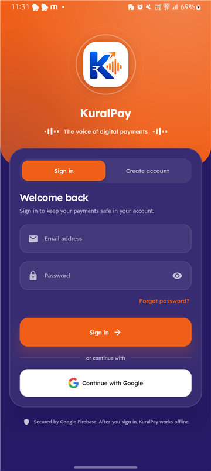
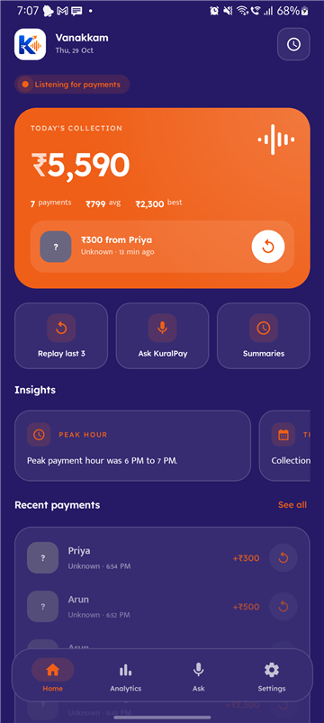
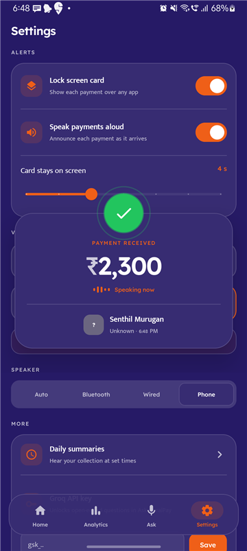
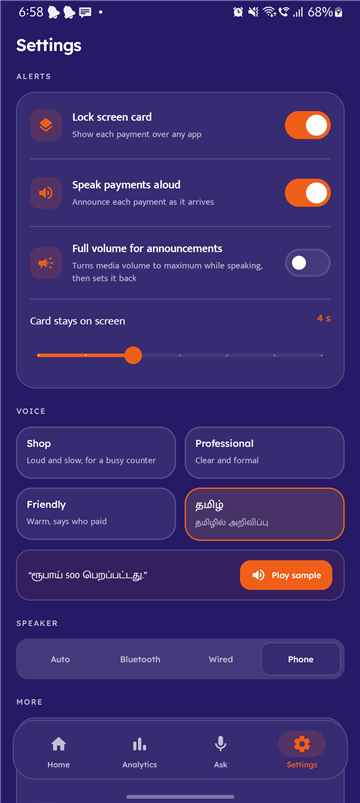
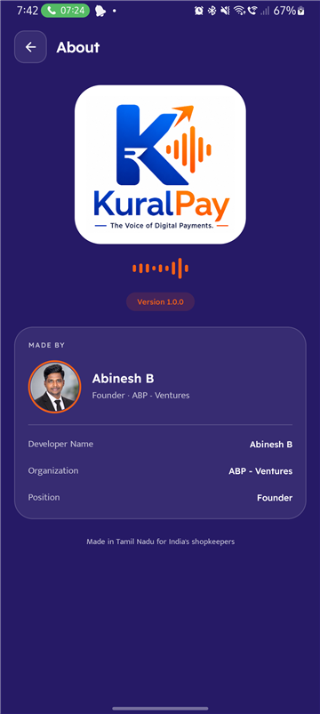

# KuralPay

**The voice of digital payments.** KuralPay listens for UPI and bank payment alerts on an Android phone and announces every payment aloud, in English or Tamil, so a shopkeeper hears "₹500 received" without looking at the screen.


| Sign in | Home | Payment card | Settings | About |
|:-:|:-:|:-:|:-:|:-:|
|  |  |  |  |  |

<sub>Screenshots use test payments.</sub>

## Features

**Hear every payment**
- Detects payments from Google Pay, PhonePe, Paytm, BHIM and Amazon Pay, and from bank credit SMS (tested against IOB and HDFC formats).
- Ignores what isn't money coming in: debits, bill and EMI reminders, payment requests, offers, cashback, OTPs, loan offers and anything from chat apps.
- Five voices: Shop, Friendly, Professional, தமிழ் (amount only) and தமிழ் நட்பு (says who paid). Uses Google's speech engine for Tamil.
- Optional full volume while announcing, restored afterwards.
- A payment card over any app or the lock screen, with a count-up amount and a live voice wave.

**Never miss one**
- Replay the last 1 to 10 payments, replay any of today's payments, or replay only the ones you missed.
- Daily voice summaries at times you choose (morning, afternoon, evening, closing).

**Your shop at a glance**
- Today's collection, payment count, average and best payment.
- Analytics by payment app and by hour.
- Home-screen widgets in three sizes.
- Ask KuralPay: voice or text questions such as "How much did I receive today?"

**Account and cloud**
- Email or Google sign-in on first launch. After that the app works offline.
- Payments and settings are backed up to Firestore and restored on a new phone.
- Payment forwarding: link another KuralPay user by mobile number and their phone announces your payments.
- Choose how long payment history is kept: forever, 30 days, 3, 6 or 12 months.
- The Groq API key is hidden behind the phone's screen lock and never leaves the phone.

## Tech stack

| Area | Built with |
|---|---|
| UI | Jetpack Compose, Material 3, custom animations, Glance widgets |
| Architecture | MVVM, Hilt, Kotlin coroutines and Flow |
| Storage | Room, DataStore |
| Cloud | Firebase Authentication (email, Google via Credential Manager), Cloud Firestore |
| Background | NotificationListenerService, foreground services, WorkManager |
| Voice | Android TextToSpeech (Google engine preferred), speech recognition |
| Build | AGP 8.5, Kotlin 2.0, Gradle 8.7, version catalog |

## Getting started

### Requirements
- Android Studio (Ladybug or newer)
- **JDK 21** for Gradle. Gradle 8.7 does not run on JDK 25: in Android Studio set *Settings → Build, Execution, Deployment → Build Tools → Gradle → Gradle JDK* to a JDK 21.
- An Android 12+ phone or emulator

### Firebase setup
`google-services.json` is not in the repository. Without it the app still builds and runs, but sign-in and cloud features are off.

1. Create a Firebase project and add an Android app with package `com.kuralpay.app`.
2. Add your SHA-1 and SHA-256 (`gradlew signingReport`), needed for Google sign-in.
3. **Authentication**: enable *Email/Password* and *Google*.
4. **Firestore**: create a database (production mode).
5. Download `google-services.json` into `app/`.
6. Deploy the security rules: point `.firebaserc` at your project, then run `firebase deploy --only firestore:rules`.

### Build and run
```bash
gradlew assembleDebug        # build
gradlew installDebug         # install on a connected phone
gradlew testDebugUnitTest    # unit tests
```

On first launch: sign in, then allow **notification access** (to read payment alerts) and **display over other apps** (for the payment card).

### Try it without a real payment
```bash
adb shell cmd notification post -t "'VM-IOBCHN-S'" test1 "'Your a/c no. XXXXX53 is credited by Rs.500.00 on 2026-10-30, from ARUN KUMAR-arun@okaxis(UPI Ref no 1)'"
```
The phone should show the payment card for ₹500 from Arun Kumar and announce it in the selected voice.

## Privacy

- Raw notification and SMS text never leaves the phone. The cloud copy holds only amount, payer name, app and time.
- A forwarded payment carries only amount and payer name, and only to people who accepted your link request.
- Firestore security rules (`firebase/firestore.rules`) let each person read and write only their own data.
- The Groq API key stays on the phone and is not part of the settings backup.

## Project layout

```
app/src/main/java/com/kuralpay/app/
├── paymentdetection/   notification listener, payment message parser
├── voice/              text-to-speech engine, announcement queue, audio routing
├── lockscreenoverlay/  payment card shown over other apps
├── ui/                 dashboard, theme, shared components
├── analytics/  assistant/  summary/  settings/  widgets/
├── account/            sign-in (email, Google)
├── forwarding/         payment forwarding between users
├── data/               Room, DataStore, repositories, cloud sync, retention
└── emergency/          replay, boot handling, recovery
firebase/firestore.rules
```

## Developer

Built by **Abinesh B**, Founder, **ABP - Ventures**. Made in Tamil Nadu for India's shopkeepers.

## License

The source code is released under the [MIT License](LICENSE). The KuralPay name, logo and the developer photo are not covered by it; see [LICENSE](LICENSE) for details and for the licences of the bundled fonts.
